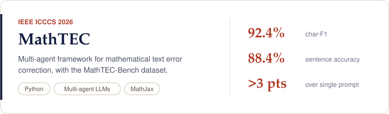
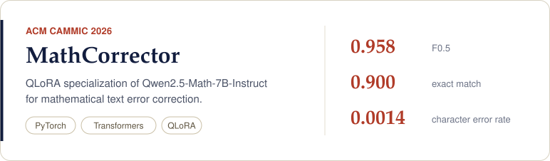
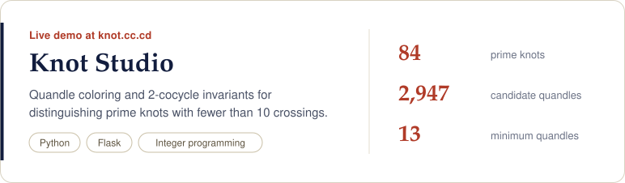

  

  

  
  
  
  

## About me

I am Xiang Li, an undergraduate at Guangdong Technion-Israel Institute of Technology, studying for a GTIIT B.Sc. in Mathematics and Applied Mathematics and a Technion bachelor's degree in Mathematics with Computer Science. My projects sit where the two meet: teaching language models to correct mathematical text, and using algebra and optimization to tell knots apart.

## Education

**Guangdong Technion-Israel Institute of Technology (GTIIT)**, Shantou, China, Aug 2023 – Jul 2027 (expected)

- GTIIT Bachelor of Science in Mathematics and Applied Mathematics
- Technion Bachelor's Degree in Mathematics with Computer Science
- Medium of instruction: English

**Relevant Coursework:** Calculus I–III, Linear Algebra, Systems Programming, Probability, Data Structures, Combinatorial Algorithms, Natural Language Processing, Numerical Analysis, Applied Mathematics

## Publications

1. **Xiang Li**, *MathTEC: A Multi-Agent Framework for Mathematical Text Error Correction*, in Proc. 2026 11th Int. Conf. on Computer and Communication Systems (ICCCS), IEEE, 2026, pp. 1154–1159. DOI: [10.1109/ICCCS69761.2026.11613421](https://doi.org/10.1109/ICCCS69761.2026.11613421). Code: [mathtec](https://github.com/mikessslx/mathtec)
2. **Xiang Li**, *Specializing Small Language Models for Mathematical Error Correction via Parameter-Efficient Fine-Tuning*, in Proc. 2026 6th Int. Conf. on Applied Mathematics, Modelling and Intelligent Computing (CAMMIC), ACM, 2026, pp. 485–489. DOI: [10.1145/3817124.3817199](https://doi.org/10.1145/3817124.3817199). Code: [mathcorrector](https://github.com/mikessslx/mathcorrector)

## Featured projects

Two published papers on correcting mathematical text, built on the same MathTEC-Bench dataset, and a computational topology project with a live demo.

<a href="https://github.com/mikessslx/mathtec">
  <picture>
    <source media="(prefers-color-scheme: dark)" srcset="assets/cards/mathtec-dark.svg" />
    
  </picture>
</a>

  
  

<a href="https://github.com/mikessslx/mathcorrector">
  <picture>
    <source media="(prefers-color-scheme: dark)" srcset="assets/cards/mathcorrector-dark.svg" />
    
  </picture>
</a>

  
  

<a href="https://github.com/mikessslx/knot-studio">
  <picture>
    <source media="(prefers-color-scheme: dark)" srcset="assets/cards/knot-studio-dark.svg" />
    
  </picture>
</a>

  
  

## Technical skills

  

<table>
  <tr>
    <td><b>Mathematics and algorithms</b></td>
    <td>Mathematical modeling, statistical analysis, machine learning, computational experimentation</td>
  </tr>
  <tr>
    <td><b>Programming</b></td>
    <td>
      
      
      
      
      
      
      
      
      </td>
  </tr>
  <tr>
    <td><b>Machine learning workflow</b></td>
    <td>Data cleaning, model training and evaluation, experiment automation, visualization</td>
  </tr>
  <tr>
    <td><b>Tools</b></td>
    <td>
      
      
      
      
      </td>
  </tr>
</table>

## GitHub activity

  
  

  

  

